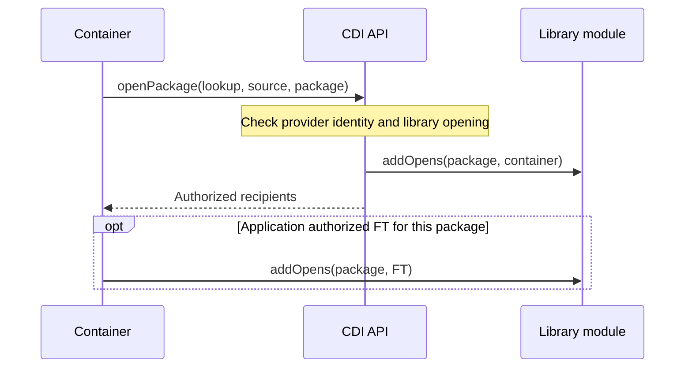

# Container relay

Experimental. The library declares `opens its.package to jakarta.cdi`, with no
container dependency or `provides` declaration.

At startup, the selected container obtains its opener through `packageOpener()`.

Vauban also prepares the library-to-container read needed by generated code.
The library jar remains unchanged.

[SE authorization](SE.md) · [Container implementation](core-patch/io/vidocq/vauban/core/container/VaubanSeContainerInitializer.java)
